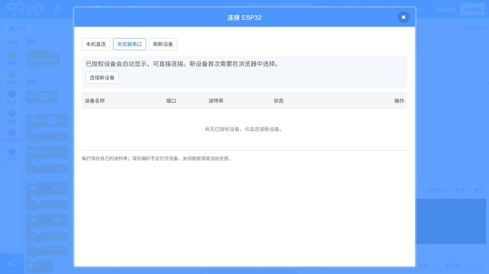

# 浏览器串口默认入口主控验收

日期：2026-11-24（Asia/Shanghai）。

## 用户行为

支持 Web Serial 时默认打开“浏览器串口”，面板自动读取本网站已授权的设备。已有设备直接从行末“连接”，无需再次授权；新设备从“连接新设备”一次页面点击接续浏览器选择和连接，删除单独授权后还要点连接的步骤。

浏览器来源的刷新和原生 discover 不调用或等待本机服务；本机服务离线不会挡住浏览器列表。另一来源缓存与活动对象、每行波特率、关闭确认和作业互斥保持。首次新设备仍由浏览器要求实际选择，网页不伪造或预先授予权限。依据 [Chrome 官方说明](https://developer.chrome.com/docs/capabilities/serial/)。

## 验收

- 前端交付类型检查、生产构建及全部 149 项测试通过，其中新增 13 项入口回归。后端只读核对确认无需修改 API。
- 主控真实本机生产页 `http://127.0.0.1:5173/`，本机 3002 服务未运行：默认浏览器来源，无独立授权按钮，无顶部本机 Failed to fetch 区；切到本机来源可看到真实离线提示，切回浏览器后隐藏。关闭、重开面板保留浏览器来源。
- 实际 1280×720 窗口中弹窗 x=190、y=16、right=1090、bottom=704，完整位于视口内；五列顺序及最右操作区结构保持。
- 本轮 IAB 的本网站许可列表为空。新设备入口进入等待真实设备选择，测试宿主没有可操作的系统选择器，取消后未打开物理串口；不能记录为本轮浏览器实体连接通过。独立逻辑验证与实际浏览器证据分别记录。
- 公网 Chrome 控制建页超时，没有将其记为线上页面渲染通过。上线后的文件/接口核对另列。
- GUI 哈希仍为 `78c7b2c43ea6eddffe6877c43b8fe677b9568849d84d45b436f9d077b1fbcbb5`；178 个 VM、15 个 Blockly 模块和原用户 PNG 字节保护通过。

## 产物

编辑器入口为 `editor-DKjvixSe.js`，样式为 `editor-D-1o8Rs6.css`。生产构建后打包并成功发布 `20261124T011700Z-cfe8ac8d`，归档 SHA-256 为 `97c3e97b36ba5c0a3848740634dbee4b3fe14d0d1f02a8424b251c8a381e5b20`。

[独立验收](../tests/BROWSER-SERIAL-DEFAULT-20261124-REPORT.md) 8 组新增跨层验证与 33 项聚焦回归全部通过，未发现阻塞项。安装包校验、Nginx 配置、HTTPS 证书与首页、编辑器、项目 API 检查通过，服务器 API 当前回环端口 9111。

线上两份 HTML、主应用与编辑器 JS/CSS、用户 Logo 均与本地编译产物逐字节一致。GUI gzip 保持 5,480,187 字节，解压字节一致，条件请求 304；约 7.73 秒仅为本次 GUI 传输时间，不表示浏览器就绪或实机验收。见 [线上核对](../tests/evidence/browser-serial-default-20261124/deployed-verification.json)。

按照用户此前测试后关闭项目进程的要求，本轮 QA PID 78940 已核对身份后停止，本机 3001/3002/5173 均无监听；未停止用户其他应用及服务器服务。本轮未启动本机硬件服务或烧录固件。普通浏览器串口可独立使用，编译/烧录及本机直连仍需用户电脑运行 `npm run hardware`。

