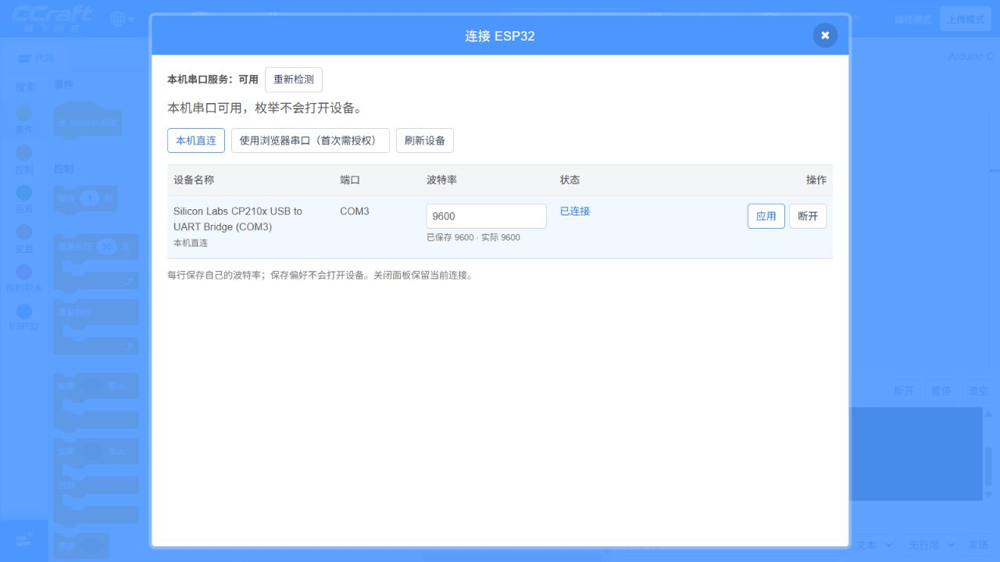
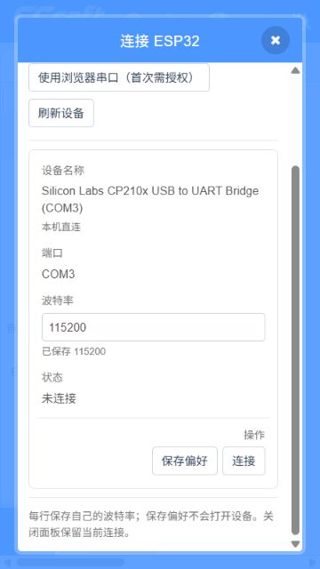

# 串口设备面板主控验收与发布

日期：2026-11-24（Asia/Shanghai）。用户恢复暂停任务后，主控沿用现有前后端设计、开发和独立测试会话完成联调。

## 最终行为

连接面板默认使用插有 USB 的电脑上的本机硬件服务，枚举所有系统串口，按“设备名称｜端口｜波特率｜状态｜操作”展示。连接、断开、应用或保存按钮均位于最右列。每个端口分别保存波特率，保存偏好不会打开设备；浏览器 Web Serial 作为明确选择的后备来源。

弹窗采用视口内的固定高度和正文滚动，标题与关闭按钮保持可见。旧版本机服务仍可显示端口目录，同时提示更新本机服务；编译工具链缺失不阻止独立串口连接。打开失败返回权威会话快照，只有确认未创建或已释放后才解除前端占用，避免失败后持续阻塞或重复打开。

## 检查结果

- 两侧开发交付：前端类型检查、生产构建及 136 项测试通过；后端类型检查、构建及 52 项测试通过。
- [独立验收](../tests/SERIAL-DEVICE-PANEL-20261124-REPORT.md)：5 组真实 Nest HTTP 与模拟驱动的跨端验证、20 项前端和 6 项后端定向回归通过。包含同 VID/PID 双设备、独立偏好、读写顺序、未知打开结果和上传互斥。
- 主控实际 COM3：115200、9600 分别真实打开、接收、校验游标、关闭，并核对目录恢复 idle。没有发送应用字节或刷写固件。见 [实体证据](../tests/evidence/serial-device-panel-20261124/physical-serial.json)。
- 主控本机生产页：从设备行直接连接 COM3，页面与共享终端显示实际 115200；行内应用 9600 后显示实际 9600，再恢复 115200 并断开。没有弹出浏览器设备选择器。
- 实际浏览器 1280×720、1366×768、1528×728、1920×910 下弹窗完整在视口内，操作位于最右列；360×640 下正文内部滚动可到达操作，标题关闭按钮仍可见。窄屏原生 IDE 背景自身存在横向宽度，本轮面板不依赖背景布局。见 [几何证据](../tests/evidence/serial-device-panel-20261124/viewport-measurements.json)。
- 受保护资源：178 个 VM、15 个 Blockly 模块、3 份上游许可逐字节一致。原用户 PNG 字节一致。GUI SHA-256 为 `78c7b2c43ea6eddffe6877c43b8fe677b9568849d84d45b436f9d077b1fbcbb5`。

## 发布

先完成生产构建，再打包 `20261124T005041Z-cfe8ac8d`。归档 SHA-256：`266b1f11ec1a91d3868da4c40a6bce97f6ddf7681a88c9fc054fe115696a8d53`。

已成功部署到 [CCraft IDE](https://ide.xiaodaiyang.top/)，服务器当前版本为 `20261124T005041Z-cfe8ac8d`，API 绑定服务器回环端口 9112。安装包校验、Nginx 配置、HTTPS 证书与首页、编辑器、健康和自定义模块接口检查均通过。

线上两份 HTML、主应用与编辑器 JS/CSS、用户 Logo 与本地生产产物逐字节一致。GUI gzip 传输为 5,480,187 字节，解压与本地一致，条件请求返回 304；本次完整传输约 7.64 秒，这不是编辑器就绪时间。见 [线上核对证据](../tests/evidence/serial-device-panel-20261124/deployed-verification.json)。

线上实际浏览器建页和读取均超时，工具不能提供可靠页面状态，因此没有报告线上浏览器面板或线上实体直连通过。本机生产页的真实浏览器、实体串口证据与线上产物一致性分别记录，不互相替代。

本机串口功能由 USB 所在电脑的 3002 服务运行，公开服务器的项目 API 不访问用户 USB。按用户此前“测试后关闭项目进程”的要求，主控确认 COM3 已恢复 idle 后，关闭本轮启动的 QA 服务 PID 80800 与硬件服务 PID 78328，并核对本机 3001/3002/5173 均无监听。没有停止其他进程或服务器服务。后续使用部署网页连接 USB 时，在 `D:\CFZN\CFZN-IDE` 运行 `npm run hardware` 启动已更新的本机服务，再于网页点击重新检测。

## 浏览器证据

本机生产版实际连接并应用 9600：

360×640 内部滚动后可访问右侧操作：

