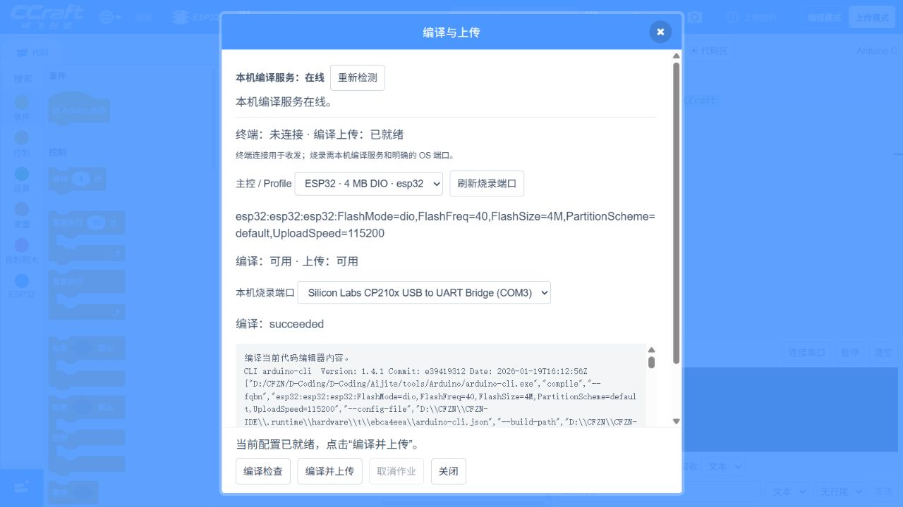

# 已连接串口但编译服务离线：主控修复与验收

日期：2026-11-24（Asia/Shanghai）。

## 原因与恢复

用户截图中浏览器终端持有串口，但编译服务、主控配置与 OS 端口列表无法访问。本机实际 3002 无监听：此前测试清理时主控也关闭了硬件执行器。浏览器 Web Serial 与本机编译/烧录是独立链路，已有终端连接不能代替执行器。

主控已用既有本机配置恢复硬件执行器 PID 72632，仅监听 `127.0.0.1:3002`。核对产品 Origin `https://ide.xiaodaiyang.top` 的 capabilities、ports 和 OPTIONS 均正常，COM3 已枚举，ESP32 的 `esp32-4mb-dio` 编译/上传能力可用。无须安装驱动、修改 CORS 许可或更换工具链；其他未配置板型继续显示真实不可用原因。

本轮会保留该执行器供用户烧录，只关闭临时 QA 网页。使用部署网页编译/烧录时，应保持 USB 所在电脑的硬件服务运行。

## 产品修复

- 编译前先判断本机服务状态，unknown/checking/offline/incompatible 不再被空 Profile 提示覆盖；按钮和实际 start 共用检查，阻止无效作业且保留终端。
- 检测成功修复当前设备空、失效或跨设备的 Profile，保留有效显式项与实际不可用原因，忙时不改变捕获配置。烧录端口仍由用户明确选择，不按浏览器 VID/PID 猜 COM。
- ports 读取失败阻止上传并显示实际原因，单独编译仍可进行。重新检测只清对应失效的启动前提示，不清真实作业错误、日志、恢复失败或未知提交状态。
- 上传弹窗区分终端连接与编译上传就绪，当前阻塞原因在正文和固定底栏可见，离线时给出启动服务与重新检测的步骤。
- HTTP schema、CLI 上传与串口释放事务、VM/Blockly 均保持原有实现。

## 实际验收

前端类型检查、生产构建与 154 项测试通过。[独立验收](../tests/UPLOAD-SERVICE-RECOVERY-20261124-REPORT.md) 的新增 7 组跨层验证与 55 项定向回归全部通过，未发现阻塞项。模拟终端保持连接、服务恢复、原生启动守卫、配置与真实作业诊断保留均单独验证。

主控使用真实执行器编译截图同类程序（Serial.begin(9600)，循环打印 Hello OpenBlock），job `1d4b9ae7-5a92-457e-a5e4-39317d8c8a63` 成功。该代码来自截图的代表性示例，不是读取用户当前未保存项目。见 [本机编译证据](../tests/evidence/upload-service-recovery-20261124/local-compilation.json)。

主控实际本机生产页选择 ESP32 后，服务在线、当前默认 Profile 自动补选、端口保持未选；明确选择 COM3 后“编译并上传”可用。随后通过真实页面点击“编译检查”，生成的空工程 job `22209a49-a51f-4afe-9257-0b3056ea0702` 成功，CLI exit=0，产物核验通过。此为真实浏览器 → 本机服务 → CLI 流程，未执行 uploads 或覆盖板上固件。见 [页面编译证据](../tests/evidence/upload-service-recovery-20261124/browser-compilation.json)。

1280×720 实际视口内，弹窗 x=310、y=16、right=970、bottom=704，操作按钮 bottom=688，标题、关闭和底部操作完整显示。

线上 Chrome 原生窗口检查被用户输入打断，后台浏览器控制未附着；主控未接管用户正在操作的标签或覆盖其项目，因此没有把本机生产页测试记作线上真实浏览器/实体烧录通过。

## 产物与发布

前端入口 `editor-DUATB_QJ.js`、样式 `editor-CwQOS_yH.css`。生产编译后打包并成功发布 `20261124T013735Z-cfe8ac8d`，归档 SHA-256 为 `cd53dd3f27d3696c4e402261f455cdc4b28c8a101e2674528f475301c131616b`。服务器安装校验、Nginx 配置、HTTPS 首页/编辑器/API 均通过，服务器 API 当前回环端口 9112。

线上两份 HTML、主应用与编辑器 JS/CSS、用户 Logo 与本地生产产物字节一致；GUI gzip 解压字节相同，条件请求 304。见 [部署证据](../tests/evidence/upload-service-recovery-20261124/deployed-verification.json)。178 个 VM、15 个 Blockly 模块和上游许可保持原字节，用户 PNG 未改动。

最终 [服务保留记录](../tests/evidence/upload-service-recovery-20261124/retained-service.json) 确认本机 PID 72632 运行，ESP32 编译/上传能力与 COM3 正常。临时 QA PID 63496 已核对身份后关闭，本机仅 3002 监听，没有停止烧录服务或服务器服务。本轮没有实体固件上传成功的断言；用户保存当前作品并刷新部署页后，可重新检测、明确选择 COM3，使用自己的当前代码重试。

